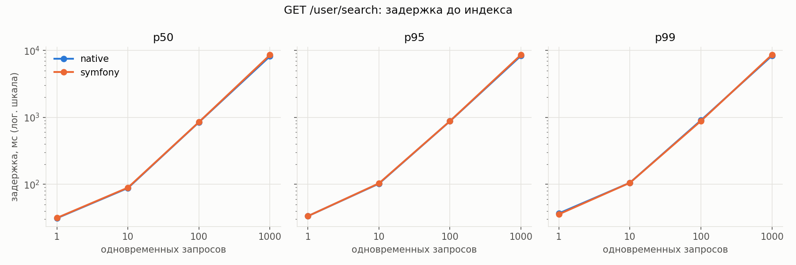
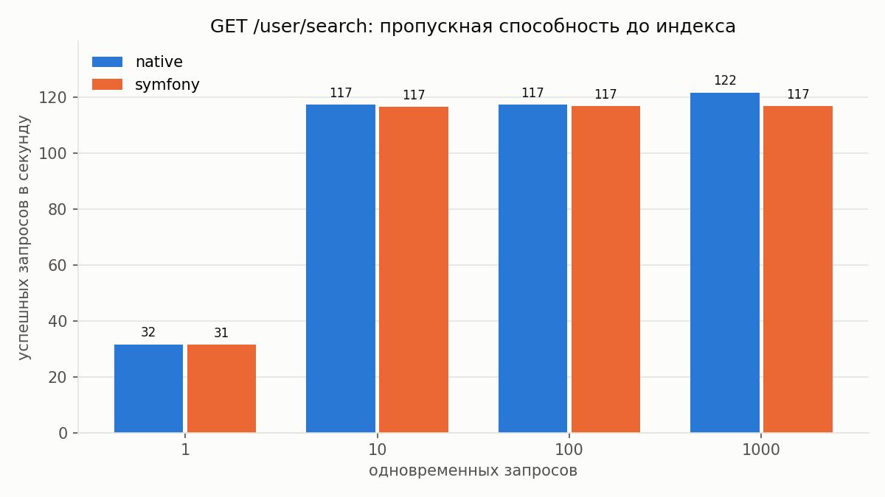
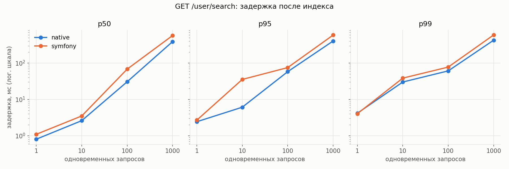
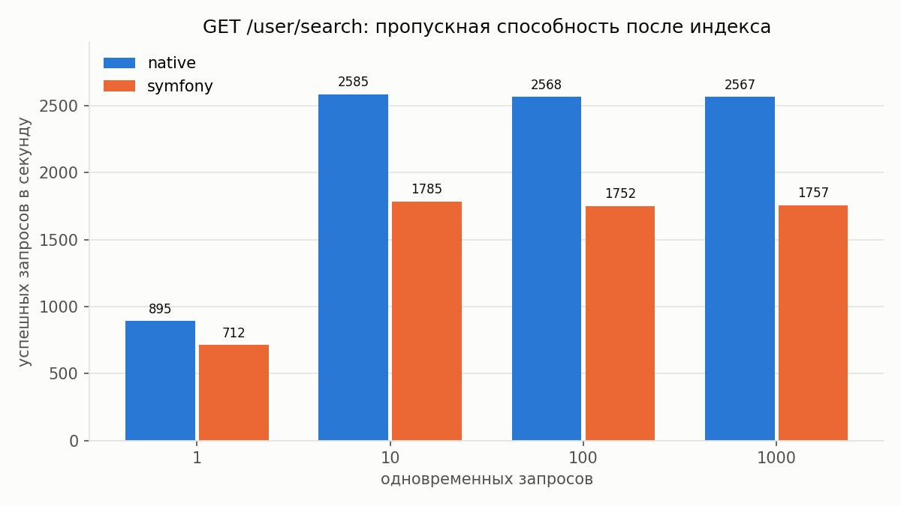
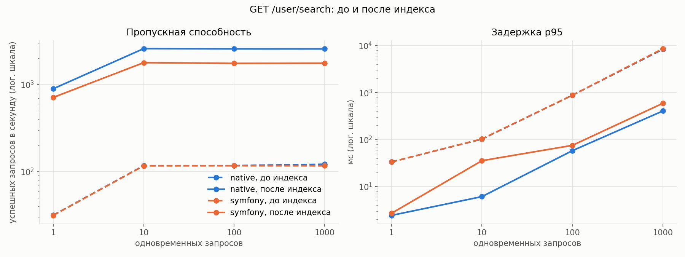

# Отчёт: производительность индексов

Цель: измерить, как индекс влияет на поиск анкет `GET /user/search` по префиксу имени и фамилии,
и обосновать выбор индекса.

Итог: составной B-tree `(last_name varchar_pattern_ops, first_name varchar_pattern_ops)` сокращает время запроса в БД
с ~28 мс до ~0,1 мс. Пропускная способность выросла в 22 раза у native (117 → 2567 RPS) и в 15 раз у Symfony (117 → 1757 RPS),
задержка p95 при 1000 одновременных запросах упала с 8,3–8,6 с до 0,4–0,6 с. Ошибок не было ни в одном прогоне.

## 1. Стенд и данные

| | |
|---|---|
| Хост | AMD Ryzen 9 9950X (16 ядер, 32 потока), 59 ГБ RAM, Linux 6.14, Docker 28.0.2 |
| Приложения | `apps/native` (чистый PHP 8.4) и `apps/symfony` (Symfony 8.1), один и тот же код поиска в Infrastructure (PDO, prepared statements) |
| Режим | `make bench-up`: код в образе, opcache без проверки файлов, без Xdebug и bind mount |
| Ресурсы php | 2 CPU и 512 МБ на контейнер, php-fpm `pm=static`, 4 воркера, постоянные соединения с БД |
| PostgreSQL | 17.10, `shared_buffers=256MB`, `work_mem=4MB`, без лимита CPU; collation базы `en_US.utf8` |
| Данные | 1 000 000 анкет (`make seed`): 999 930 реальных строк из `db/seed/people.v2.csv` и 70 собранных из реальных имён и фамилий. 138 различных имён, 1006 фамилий. Таблица 207 МБ, целиком помещается в `shared_buffers` |

## 2. Функционал

`GET /user/search?first_name=<префикс>&last_name=<префикс>` (контракт в [`docs/openapi.json`](../openapi.json)):
анкеты, у которых имя начинается с `first_name` и одновременно фамилия начинается с `last_name`, отсортированные по `id`.
Поиск регистрозависимый, `%` и `_` в префиксе ищутся буквально. Запрос приложения:

```sql
SELECT id, first_name, last_name, birth_date, gender, interests, city, password_hash
FROM users
WHERE first_name LIKE :first_name ESCAPE '\' AND last_name LIKE :last_name ESCAPE '\'
ORDER BY id
```

Параметры: префикс с экранированными `\`, `%`, `_` и `%` в конце, например `Кон%`, `Оси%`.

## 3. Методика нагрузки

- Инструмент: [k6](https://k6.io) 1.3.0 в docker с `--network host`, сценарий [`search.js`](../../social-network-docker/bench/search.js),
  обвязка [`search.sh`](../../social-network-docker/bench/search.sh) (`make bench-search PHASE=before|after`).
- Модель замкнутая (`constant-vus`): N виртуальных пользователей шлют запросы без пауз, соединения keep-alive.
  N = 1, 10, 100, 1000. На каждый уровень 10 с прогрева (не учитывается) и 60 с замера. Сначала native, затем Symfony.
- Запросы: случайная пара из [`search-queries.csv`](../../social-network-docker/bench/search-queries.csv), 1000 пар
  «3 буквы имени, 3 буквы фамилии» из случайных анкет (популярные имена встречаются чаще, как в реальном поиске).
  До и после индекса гоняется один и тот же файл. Размер выдачи: медиана ~89 анкет, p90 ~363, максимум 1388.
- Метрики: успешные запросы в секунду; задержка p50/p95/p99/max с точки зрения клиента (включая ожидание в очереди nginx и php-fpm); доля ошибок.
- Индекс между фазами — единственное изменение: стек, данные и набор запросов те же.

## 4. До индекса





| Приложение | Конкурентность | Запросов | Успешных RPS | Ошибок | p50, мс | p95, мс | p99, мс | max, мс |
|---|---:|---:|---:|---:|---:|---:|---:|---:|
| native | 1 | 1897 | 31.6 | 0.00% | 31.1 | 33.4 | 36.8 | 66.2 |
| native | 10 | 7041 | 117.2 | 0.00% | 87.8 | 102.1 | 105.5 | 164.8 |
| native | 100 | 7133 | 117.2 | 0.00% | 846.8 | 876.5 | 904.8 | 934.9 |
| native | 1000 | 8313 | 121.6 | 0.00% | 8189.1 | 8324.5 | 8348.3 | 8373.7 |
| symfony | 1 | 1887 | 31.4 | 0.00% | 31.4 | 33.4 | 35.6 | 37.2 |
| symfony | 10 | 7000 | 116.5 | 0.00% | 89.1 | 103.2 | 105.4 | 118.3 |
| symfony | 100 | 7108 | 116.8 | 0.00% | 851.2 | 879.5 | 884.8 | 891.6 |
| symfony | 1000 | 7995 | 116.7 | 0.00% | 8559.2 | 8599.9 | 8617.5 | 8631.5 |

Без индекса каждый запрос — `Parallel Seq Scan` по всему миллиону строк (~28 мс в БД, ~31 мс с HTTP).
Четыре воркера php-fpm ждут БД, отсюда потолок 4 / 0,034 с ≈ 117 RPS, достигнутый уже на 10 одновременных запросах.
Дальше растёт только очередь: задержка ≈ N / 117 с (100 → 0,85 с, 1000 → 8,5 с, закон Литтла).
Фреймворк не влияет: время почти целиком уходит в PostgreSQL.

## 5. Индекс

Запрос добавления индекса ([`db/migrations/002_create_users_name_prefix_index.sql`](../../db/migrations/002_create_users_name_prefix_index.sql)):

```sql
CREATE INDEX users_last_name_first_name_prefix_idx
    ON users (last_name varchar_pattern_ops, first_name varchar_pattern_ops);
```

Построение на миллионе строк: 0,35 с, размер 9,6 МБ (первичный ключ — 38 МБ).

### Почему индекс именно такой

1. **B-tree.** Префиксный `LIKE 'Оси%'` равносилен диапазону `last_name >= 'Оси' AND last_name < 'Осй'`,
   а диапазоны — то, для чего B-tree и создан. Это видно в `Index Cond` планов ниже.
2. **`varchar_pattern_ops`.** Collation базы `en_US.utf8`: строки упорядочены по правилам локали, а не побайтово,
   поэтому обычный B-tree для `LIKE` не применяется (проверено: с индексом без `pattern_ops` план остался `Seq Scan`).
   Классы `*_pattern_ops` сравнивают строки посимвольно, и диапазон по префиксу становится корректным.
   Альтернатива с тем же эффектом — колонки или индекс с `COLLATE "C"`.
3. **Составной на обе колонки.** Условия по обеим колонкам попадают в `Index Cond`: строки, у которых не подходит имя,
   отсекаются прямо в индексе, в таблицу идём только за найденными (27 строк — 23 страницы таблицы).
   С двумя отдельными индексами PostgreSQL достаёт по каждому десятки тысяч кандидатов и пересекает их (`BitmapAnd`), это в 6 раз медленнее.
4. **Фамилия первой.** Диапазон по первой колонке определяет, какую часть индекса придётся просмотреть,
   а фамилия селективнее имени: 1006 различных фамилий против 138 имён.
   Для «Але» + «Ива» индекс `(last_name, first_name)` читает 25 страниц индекса, `(first_name, last_name)` — 61.
5. **Не GIN `pg_trgm`.** Триграммы нужны для поиска по подстроке в середине слова. Для префикса они втрое больше и в 3 раза медленнее B-tree.
6. **Без покрывающего индекса (`INCLUDE`).** Ответу нужны все колонки анкеты, включение их в индекс почти удвоило бы его размер.
   Сортировку по `id` индекс не обслуживает (он упорядочен по фамилии), но после отбора остаются десятки строк, и сортировка в памяти занимает микросекунды.

### Сравнение вариантов

Каждый вариант создавался в транзакции и откатывался, затем выполнялись все 1000 запросов набора нагрузки
([`compare-indexes.sql`](../../social-network-docker/bench/compare-indexes.sql), сырой вывод — [`explain/index-variants.txt`](explain/index-variants.txt)):

| Вариант | Размер | 1000 запросов | «Кон» + «Оси» (27 строк) | «Але» + «Ива» (1388 строк) |
|---|---:|---:|---:|---:|
| без индекса | — | 28 539 мс | 27,7 мс, Parallel Seq Scan | 28,7 мс |
| **`(last_name, first_name)` `varchar_pattern_ops`** | 9,6 МБ | **131 мс** | **0,035 мс** | **0,74 мс** |
| `(first_name, last_name)` `varchar_pattern_ops` | 9,6 МБ | 151 мс | 0,043 мс | 0,79 мс |
| два отдельных `varchar_pattern_ops` | 6,8 + 7,0 МБ | 774 мс | 0,45 мс, BitmapAnd | 2,5 мс |
| GIN `pg_trgm` на обе колонки | 29 МБ | 375 мс | 0,21 мс | 1,4 мс |
| `(last_name, first_name)` без `pattern_ops` | 9,6 МБ | 29 144 мс | не используется | не используется |

### EXPLAIN после индекса

Полный вывод: [`explain/after-index.txt`](explain/after-index.txt).

Типичный запрос:

```
 Sort  (cost=143.36..143.41 rows=22 width=171) (actual time=0.103..0.104 rows=27 loops=1)
   Sort Key: id
   Sort Method: quicksort  Memory: 30kB
   Buffers: shared hit=33
   ->  Bitmap Heap Scan on users  (cost=56.44..142.87 rows=22 width=171) (actual time=0.048..0.078 rows=27 loops=1)
         Filter: (((first_name)::text ~~ 'Кон%'::text) AND ((last_name)::text ~~ 'Оси%'::text))
         Heap Blocks: exact=23
         Buffers: shared hit=30
         ->  Bitmap Index Scan on users_last_name_first_name_prefix_idx  (cost=0.00..56.43 rows=22 width=0) (actual time=0.036..0.036 rows=27 loops=1)
               Index Cond: (((last_name)::text ~>=~ 'Оси'::text) AND ((last_name)::text ~<~ 'Осй'::text) AND ((first_name)::text ~>=~ 'Кон'::text) AND ((first_name)::text ~<~ 'Коо'::text))
               Buffers: shared hit=7
 Planning Time: 0.628 ms
 Execution Time: 0.140 ms
```

Самая большая выдача из набора нагрузки:

```
 Sort  (cost=4793.15..4796.44 rows=1315 width=171) (actual time=1.657..1.700 rows=1388 loops=1)
   Sort Key: id
   Sort Method: quicksort  Memory: 314kB
   Buffers: shared hit=566
   ->  Bitmap Heap Scan on users  (cost=431.75..4725.03 rows=1315 width=171) (actual time=0.228..1.159 rows=1388 loops=1)
         Filter: (((first_name)::text ~~ 'Але%'::text) AND ((last_name)::text ~~ 'Ива%'::text))
         Heap Blocks: exact=541
         Buffers: shared hit=566
         ->  Bitmap Index Scan on users_last_name_first_name_prefix_idx  (cost=0.00..431.42 rows=1310 width=0) (actual time=0.131..0.131 rows=1388 loops=1)
               Index Cond: (((last_name)::text ~>=~ 'Ива'::text) AND ((last_name)::text ~<~ 'Ивб'::text) AND ((first_name)::text ~>=~ 'Але'::text) AND ((first_name)::text ~<~ 'Алж'::text))
               Buffers: shared hit=25
 Planning Time: 0.090 ms
 Execution Time: 1.784 ms
```

Нет совпадений:

```
 Sort  (cost=8.47..8.47 rows=1 width=171) (actual time=0.018..0.018 rows=0 loops=1)
   Sort Key: id
   ->  Index Scan using users_last_name_first_name_prefix_idx on users  (cost=0.42..8.46 rows=1 width=171) (actual time=0.009..0.009 rows=0 loops=1)
         Index Cond: (((last_name)::text ~>=~ 'Zzz'::text) AND ((last_name)::text ~<~ 'Zz{'::text) AND ((first_name)::text ~>=~ 'Zzz'::text) AND ((first_name)::text ~<~ 'Zz{'::text))
         Filter: (((first_name)::text ~~ 'Zzz%'::text) AND ((last_name)::text ~~ 'Zzz%'::text))
 Execution Time: 0.035 ms
```

Как запрос выполняет приложение — prepared statement с параметрами (`PDO::ATTR_EMULATE_PREPARES => false`):

```
PREPARE search(text, text) AS SELECT ... WHERE first_name LIKE $1 ESCAPE '\' AND last_name LIKE $2 ESCAPE '\' ORDER BY id;
EXPLAIN (ANALYZE, BUFFERS) EXECUTE search('Кон%', 'Оси%');

 Sort  (cost=143.36..143.41 rows=22 width=171) (actual time=0.041..0.042 rows=27 loops=1)
   ->  Bitmap Heap Scan on users  (cost=56.44..142.87 rows=22 width=171) (actual time=0.021..0.032 rows=27 loops=1)
         ->  Bitmap Index Scan on users_last_name_first_name_prefix_idx  (cost=0.00..56.43 rows=22 width=0) (actual time=0.017..0.017 rows=27 loops=1)
               Index Cond: (((last_name)::text ~>=~ 'Оси'::text) AND ((last_name)::text ~<~ 'Осй'::text) AND ((first_name)::text ~>=~ 'Кон'::text) AND ((first_name)::text ~<~ 'Коо'::text))
 Execution Time: 0.066 ms
```

Нюанс параметризованного `LIKE`: в generic plan (без значений параметров) префикс неизвестен, и индекс применить нельзя
(`SET plan_cache_mode = force_generic_plan` даёт `Parallel Seq Scan`). На практике PostgreSQL строит custom plan под значения:
PDO готовит запрос заново в каждом HTTP-запросе, а generic plan стоил бы на порядки дороже (33 тыс. против 143), и планировщик на него не переключается.

## 6. После индекса





| Приложение | Конкурентность | Запросов | Успешных RPS | Ошибок | p50, мс | p95, мс | p99, мс | max, мс |
|---|---:|---:|---:|---:|---:|---:|---:|---:|
| native | 1 | 53672 | 894.5 | 0.00% | 0.8 | 2.4 | 4.2 | 8.1 |
| native | 10 | 155136 | 2585.4 | 0.00% | 2.6 | 6.1 | 30.2 | 39.4 |
| native | 100 | 154187 | 2567.8 | 0.00% | 30.7 | 58.1 | 61.1 | 71.2 |
| native | 1000 | 154963 | 2566.9 | 0.00% | 391.3 | 405.9 | 427.3 | 445.5 |
| symfony | 1 | 42693 | 711.5 | 0.00% | 1.1 | 2.7 | 4.1 | 7.8 |
| symfony | 10 | 107088 | 1784.7 | 0.00% | 3.5 | 35.5 | 38.6 | 46.6 |
| symfony | 100 | 105188 | 1751.9 | 0.00% | 68.3 | 75.3 | 77.8 | 84.9 |
| symfony | 1000 | 106410 | 1756.9 | 0.00% | 575.6 | 591.4 | 596.6 | 644.0 |

После индекса запрос в БД занимает доли миллисекунды, и узким местом становится CPU php-контейнера:
выборка, сборка объектов и сериализация в среднем ~90 анкет на ответ. Лимит 2 CPU подтверждают счётчики cgroup:
php-контейнеры троттлились примерно в 36% периодов планировщика. Отсюда:

- потолок 2570 RPS у native и 1755 у Symfony, разница — накладные расходы фреймворка, которые без индекса прятались за ожиданием БД;
- хвосты p99 ≈ 30–40 мс уже при 10 одновременных запросах: процесс, исчерпавший квоту CPU, ждёт следующего периода (100 мс);
- при 100 и 1000 растёт только очередь, задержка ≈ N / RPS (1000 / 2567 ≈ 0,39 с).

## 7. До и после



| Конкурентность | RPS native до → после | RPS symfony до → после | p95 native до → после | p95 symfony до → после |
|---:|---:|---:|---:|---:|
| 1 | 31,6 → 894,5 (×28) | 31,4 → 711,5 (×23) | 33,4 → 2,4 мс | 33,4 → 2,7 мс |
| 10 | 117,2 → 2585,4 (×22) | 116,5 → 1784,7 (×15) | 102,1 → 6,1 мс | 103,2 → 35,5 мс |
| 100 | 117,2 → 2567,8 (×22) | 116,8 → 1751,9 (×15) | 876,5 → 58,1 мс | 879,5 → 75,3 мс |
| 1000 | 121,6 → 2566,9 (×21) | 116,7 → 1756,9 (×15) | 8324,5 → 405,9 мс | 8599,9 → 591,4 мс |

## 8. Ограничения замера

- Генератор нагрузки работает на том же хосте, что и стек. Абсолютные числа — ориентир; сравнение до и после корректно, так как условия одинаковые.
- Модель замкнутая: при перегрузке клиент не шлёт новых запросов, пока не получил ответ, поэтому хвосты задержки занижены
  относительно открытой модели с фиксированным потоком (coordinated omission).
- RPS считается по времени теста k6, включая до 30 с ожидания запросов, оставшихся в обработке после конца замера.
  Поэтому у native при 1000 до индекса 121,6 RPS при реальном потолке ~117.
- Таблица и индекс целиком в `shared_buffers`: замер показывает работу с памятью, без чтения с диска.
- 38 раз за фазу «до» nginx записывал большие ответы (сотни анкет) во временный файл: не хватило `fastcgi_buffers`.
  Ошибок это не вызывает и одинаково для обоих приложений; буферы не менялись, чтобы не трогать условия между фазами.

## 9. Как воспроизвести

```
make reset-db && make bench-up && make seed
docker compose exec postgres sh -c 'psql -U "$POSTGRES_USER" -d "$POSTGRES_DB" -c "DROP INDEX users_last_name_first_name_prefix_idx"'
make bench-search PHASE=before
docker compose exec postgres sh -c 'psql -U "$POSTGRES_USER" -d "$POSTGRES_DB" -f /docker-entrypoint-initdb.d/002_create_users_name_prefix_index.sql -c "ANALYZE users"'
make bench-search PHASE=after
make bench-plot
```

Миграция 002 применяется при инициализации пустой БД, поэтому для фазы «до» индекс удаляется вручную.
