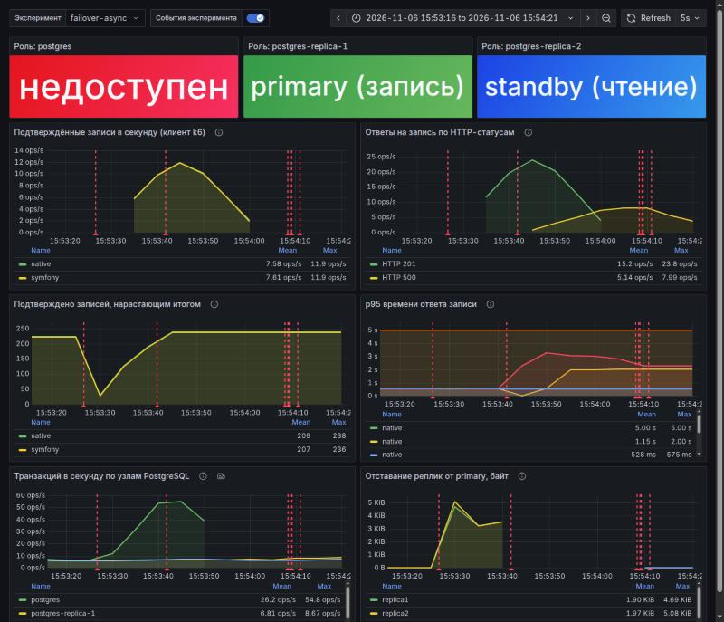
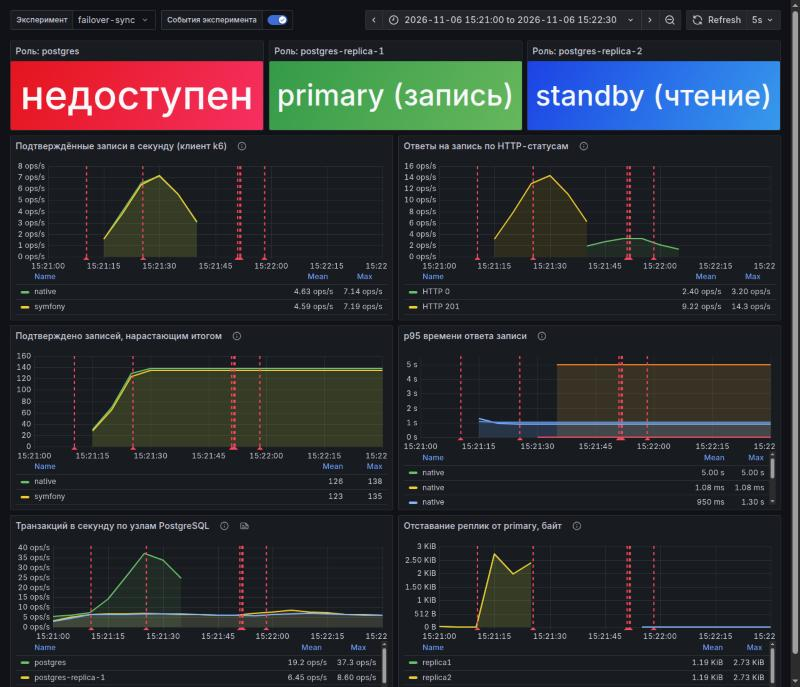

# Отчёт: репликация PostgreSQL

Цель: настроить потоковую репликацию PostgreSQL (1 primary и 2 реплики), перенести чтение на реплики, измерить эффект,
настроить кворумную синхронную репликацию и проверить, теряются ли подтверждённые транзакции при аварийной остановке мастера.

## Итоги

- Репликация потоковая, 1 primary + 2 реплики на чистом `postgres:17.10-alpine` (без Patroni и менеджеров кластера).
  Реплики создаются `pg_basebackup -R`, подключаются к primary и опознаются по `application_name` (`replica1`, `replica2`).
- Запросы `GET /user/get/{id}` и `GET /user/search` читают с реплик через HAProxy, запись (`POST /user/register`) и
  логин идут на primary. Во время нагрузки на primary приходится 16–17 служебных транзакций на прогон, остальное делят реплики
  (49,8–50,1% на каждую).
- Пропускная способность выросла там, где узким местом была БД: `get` native ×2,5, `search` native ×2,0, `search` Symfony ×1,4.
  Там, где упирается php (`get` Symfony), прироста нет (×0,97). Подробности и причины в разделе 4.
- Аварийная остановка primary (`kill -9`) под нагрузкой на запись с задержкой репликации 300 мс:
  **async потерял 6 из 474 подтверждённых клиенту записей, кворумная синхронная репликация потеряла 0 из 275** (раздел 6).

Все цифры из каталога [`results/`](results/), скрипты и команды воспроизведения в разделе 8.

## 1. Стенд и топология

```
php-native ─┐                          ┌─► postgres            (primary: запись, логин)
            ├─ DB_HOST ────────────────┘
php-symfony ┘
            └─ DB_READ_HOST ─► haproxy ─┬─► postgres-replica-1 (replica1: чтение)
                                        └─► postgres-replica-2 (replica2: чтение)
```

|  |  |
|---|---|
| Хост | AMD Ryzen 9 9950X (16 ядер, 32 потока), 59 ГБ RAM, Linux 6.14, Docker 28.0.2 |
| Приложения | `apps/native` (PHP 8.4) и `apps/symfony` (Symfony 8.1), режим bench: код в образе, 2 CPU и 512 МБ на контейнер, php-fpm `pm=static`, 4 воркера, постоянные соединения с БД |
| PostgreSQL | 17.10, три узла с одинаковыми лимитами **0,5 CPU и 1 ГБ** и одним `postgresql.conf` (`shared_buffers=256MB`, `work_mem=4MB`) |
| Балансировщик | HAProxy 3.0.11, `mode tcp`, `balance roundrobin`, проверка `pgsql-check` |
| Данные | 1 000 000 анкет (`make seed`), составной индекс `(last_name, first_name)` с `*_pattern_ops` для поиска |
| Мониторинг | Prometheus, 3 × postgres_exporter, cAdvisor, Grafana (профиль compose `monitoring`, в замеры не входит) |

Все сервисы работают в Docker Compose, версии образов закреплены.

## 2. Как настроена репликация

### 2.1 Primary

Файл [`social-network-docker/postgres/postgresql.conf`](../../social-network-docker/postgres/postgresql.conf) общий для всех трёх
узлов. Параметры репликации:

```
wal_level = replica
max_wal_senders = 10
wal_keep_size = 1GB
hot_standby = on
wal_log_hints = on
```

- `wal_level = replica` и `max_wal_senders` позволяют отдавать WAL репликам.
- `wal_keep_size = 1GB` сохраняет запас WAL на primary для отставшей реплики. **Слоты репликации не используются**:
  при failover их пришлось бы пересоздавать на новом мастере, а запас WAL решает ту же задачу без лишних шагов.
  Цена: реплика, отставшая больше чем на гигабайт WAL, пересоздаётся заново.
- `hot_standby = on` разрешает чтение на реплике.
- `wal_log_hints = on` нужен `pg_rewind`, чтобы потом вернуть старый primary в кластер репликой (в работе не использовалось).

При первой инициализации тома primary выполняются скрипты [`initdb/`](../../social-network-docker/postgres/initdb/):

1. `000_replication.sh` создаёт отдельную роль `replicator` (`LOGIN REPLICATION`, доступа к данным нет) и добавляет в
   `pg_hba.conf` строку `host replication replicator all scram-sha-256`. Строку нужно добавлять отдельно: `all` в поле базы
   подключения репликации не покрывает.
2. `010_monitoring.sh` создаёт роль `exporter` (только `pg_monitor`) для postgres_exporter.
3. `100_migrations.sh` применяет миграции из `db/migrations`.

Пароль репликации передаётся только через окружение (`REPLICATION_PASSWORD` в `.env`).

### 2.2 Реплики

Каждая реплика при старте на пустом томе выполняет [`replica-entrypoint.sh`](../../social-network-docker/postgres/replica-entrypoint.sh):

```
pg_basebackup -d "host=postgres user=replicator password=... application_name=replica1" \
              -D $PGDATA --wal-method=stream --write-recovery-conf
```

- `--wal-method=stream` забирает WAL параллельно с копированием данных, база получается согласованной.
- `--write-recovery-conf` (`-R`) создаёт `standby.signal` и записывает `primary_conninfo` в `postgresql.auto.conf`.
  PostgreSQL по `standby.signal` стартует в режиме восстановления и непрерывно получает WAL с primary: это и есть потоковая репликация.
- `application_name` в `primary_conninfo` нужен для кворумной синхронной репликации: primary опознаёт реплику по этому имени.
- После копирования управление передаётся штатному `docker-entrypoint.sh`, поэтому реплика далее ведёт себя как обычный узел postgres.

Замечание по безопасности: `-R` сохраняет пароль репликации открытым текстом в `postgresql.auto.conf` внутри тома реплики.
Это стандартное поведение; для продакшена используют `passfile` или сертификаты.

### 2.3 Проверка

`make repl-status` показывает роли узлов, подключённые реплики и лаг. После сида миллиона строк (`make seed`):

```
 replica  | client_addr |   state   | sync_state | primary_lsn | replay_lsn | lag_bytes |   replay_lag
----------+-------------+-----------+------------+-------------+------------+-----------+-----------------
 replica1 | 172.22.0.4  | streaming | async      | 0/1D9D26A8  | 0/1D9D26A8 |         0 | 00:00:00.00099
 replica2 | 172.22.0.3  | streaming | async      | 0/1D9D26A8  | 0/1D9D26A8 |         0 | 00:00:00.000966
```

Реплики видят те же 1 000 000 строк и оба индекса, запись на реплике отвергается
(`cannot execute DELETE in a read-only transaction`), анкеты, созданные через оба приложения, появляются на обеих репликах.

## 3. Как приложения работают с репликацией

В PHP нет аналога `@Transactional(readOnly = true)`, поэтому решение «куда идти» принимается на уровне use case в
composition root каждого приложения ([`apps/native/config/container.php`](../../apps/native/config/container.php),
[`apps/symfony/config/services.yaml`](../../apps/symfony/config/services.yaml)). Подходы в приложениях эквивалентны,
в `packages/core` изменений нет. Создаются два подключения и два экземпляра одного и того же `PdoUserRepository`:

| Use case | Куда ходит | Почему |
|---|---|---|
| `POST /user/register` | primary (`DB_HOST`) | запись |
| `POST /login` | primary | логин идёт сразу после регистрации и не должен упереться в лаг реплики |
| `GET /user/get/{id}` | реплики (`DB_READ_HOST`), при промахе primary | чтение; возврат к primary см. ниже |
| `GET /user/search` | реплики | чтение |

В Symfony общего алиаса `UserRepository` и `PDO` по умолчанию нет намеренно: новый use case обязан выбрать явно.

**Балансировка.** `DB_READ_HOST` указывает на HAProxy, который раскладывает TCP-соединения по двум репликам по кругу и
исключает реплику, не отвечающую на проверку `pgsql-check` (4 с). Соединения php-fpm постоянные, поэтому реплика выбирается
один раз, когда воркер подключается. Следствие: у одного приложения воркеры могут оказаться на одной реплике. В смоук-прогоне
после чужих запросов (тесты, Postman) вся нагрузка native ушла на replica1: +25 512 транзакций против +3 на replica2, RPS остался как
без реплик. Поэтому `read.sh` перед замером перезапускает php-контейнеры, воркеры подключаются подряд, и round-robin раскладывает их 2+2.

**Read-your-writes.** Репликация асинхронна, поэтому свежесозданная анкета может ещё не быть на реплике. До добавления
возврата к primary `make compare` давал расхождение в 5 прогонах из 6: `GET` сразу после `register` отвечал 404.
Теперь `GET /user/get/{id}` при промахе реплики перечитывает primary (`PrimaryFallbackUserRepository`, 10 прогонов `compare` из 10 чистые).
Особенности:

- primary подключается лениво, только при промахе, поэтому чтение не зависит от его доступности;
- если primary недоступен, промах реплики отвечает 404, а не 500;
- цена: `get` несуществующего id тоже доходит до primary; поиск по префиксу так не проверить, он читает только реплику.

Тесты: контракт порта `UserRepository` прогоняется и на декораторе, а отставшая реплика моделируется вторым соединением, которое не
видит незакоммиченные записи primary (без моков).

## 4. Нагрузочное тестирование чтения

### 4.1 План

Два запроса из спецификации: `GET /user/get/{id}` и `GET /user/search`.

- Инструмент: [k6](https://k6.io) 1.3.0, замкнутая модель (`constant-vus`), 1 / 10 / 100 / 1000 виртуальных пользователей,
  прогрев 10 с (не учитывается) и замер 60 с, сначала native, затем Symfony. Режим bench, `make bench-read PHASE=<фаза>`.
- `get`: 10 000 случайных id из БД ([`get-ids.sh`](../../social-network-docker/bench/get-ids.sh)). Один и тот же id нельзя:
  он целиком оседает в кэше.
- `search`: 1000 пар «3 буквы имени, 3 буквы фамилии» из случайных анкет ([`search-queries.csv`](../../social-network-docker/bench/search-queries.csv)).
- Фазы: **baseline** (всё чтение на единственный узел postgres) и **replicas** (чтение через HAProxy на две реплики).
- Во время замера каждые 5 с снимаются CPU и память контейнеров (`docker-stats.log`), а до и после каждого прогона счётчики
  `pg_stat_database` по трём узлам (`node-stats.csv`).

### 4.2 Почему лимит postgres 0,5 CPU

Первый baseline снят при лимите 2 CPU на узел ([`results/baseline-pg2cpu/`](results/baseline-pg2cpu/)). Он показал, что реплики ничего не
дали бы: контейнер php упирается в свой лимит 2 CPU (пик около 204%), а postgres использует не больше 133% из доступных 200%.

RPS при 1000 VU:

| | postgres 2 CPU | postgres 0,5 CPU |
|---|---|---|
| `get` native | 10 033 | 3 600 |
| `get` Symfony | 3 319 | 3 307 |
| `search` native | 2 616 | 1 284 |
| `search` Symfony | 1 784 | 1 295 |

Чтобы эффект репликации было видно, лимит всех узлов БД понижен до 0,5 CPU: тогда в baseline postgres упирается в свой
лимит (около 51% при потолке 50%) в трёх сценариях из четырёх. Это методическое решение, а не оптимизация: в отчёте сравниваются
конфигурации с **одинаковыми** лимитами узлов. Оно фиксируется в `.env` (`POSTGRES_CPUS`, `POSTGRES_MEMORY`).

### 4.3 Результаты

RPS и p95 (мс), успешных запросов 100% во всех прогонах (ошибок 0).

**`GET /user/get/{id}`**

| Приложение | VU | baseline RPS | baseline p95 | replicas RPS | replicas p95 | RPS × |
|---|---|---|---|---|---|---|
| native | 1 | 2523 | 0,5 | 2246 | 0,5 | 0,89 |
| native | 10 | 3738 | 1,2 | 9883 | 1,1 | 2,64 |
| native | 100 | 3660 | 77,0 | 9423 | 13,2 | 2,57 |
| native | 1000 | 3600 | 301,1 | 9092 | 118,2 | 2,53 |
| symfony | 1 | 1369 | 0,8 | 1206 | 0,9 | 0,88 |
| symfony | 10 | 3461 | 2,2 | 3277 | 2,4 | 0,95 |
| symfony | 100 | 3441 | 58,0 | 3262 | 55,8 | 0,95 |
| symfony | 1000 | 3307 | 342,5 | 3210 | 345,9 | 0,97 |

**`GET /user/search`**

| Приложение | VU | baseline RPS | baseline p95 | replicas RPS | replicas p95 | RPS × |
|---|---|---|---|---|---|---|
| native | 1 | 978 | 2,3 | 911 | 2,4 | 0,93 |
| native | 10 | 1312 | 66,6 | 2594 | 6,0 | 1,98 |
| native | 100 | 1296 | 96,4 | 2553 | 49,0 | 1,97 |
| native | 1000 | 1284 | 806,8 | 2553 | 413,8 | 1,99 |
| symfony | 1 | 737 | 2,6 | 698 | 2,7 | 0,95 |
| symfony | 10 | 1306 | 55,8 | 1799 | 32,8 | 1,38 |
| symfony | 100 | 1296 | 94,6 | 1774 | 73,4 | 1,37 |
| symfony | 1000 | 1295 | 806,9 | 1787 | 585,7 | 1,38 |

### 4.4 Нагрузка перешла на реплики

Прирост счётчиков `pg_stat_database` (`xact_commit`) за прогон при 1000 VU, из [`results/replicas/node-stats.csv`](results/replicas/node-stats.csv):

| Прогон | primary | replica1 | replica2 | доля replica1 |
|---|---|---|---|---|
| `get` native | 16 | 539 946 | 538 566 | 50,1% |
| `get` Symfony | 17 | 194 139 | 193 724 | 50,1% |
| `search` native | 16 | 154 390 | 154 483 | 50,0% |
| `search` Symfony | 16 | 107 883 | 108 655 | 49,8% |

Во всех 16 прогонах primary получил 16–17 транзакций (это мои собственные запросы счётчиков), доля replica1 лежит в пределах 49,8–50,1%.
На дашборде «Нагрузка: контейнеры и HAProxy» то же видно как нулевая линия primary и две почти совпадающие линии реплик.

### 4.5 Почему прирост разный

Пиковый CPU контейнеров при 1000 VU, % одного ядра (из `docker-stats.log`):

| Прогон | baseline: php / postgres | replicas: php / replica1 / replica2 / haproxy |
|---|---|---|
| `get` native | 82 / 51 | 166 / 54 / 53 / 45 |
| `get` Symfony | 204 / 46 | 205 / 25 / 25 / 18 |
| `search` native | 100 / 51 | 192 / 51 / 51 / 19 |
| `search` Symfony | 146 / 52 | 203 / 39 / 39 / 15 |

(лимиты: php 200%, узел postgres 50%.)

- **`get` и `search` native**: в baseline postgres на пределе (51%), php свободен. С двумя репликами суммарный лимит БД вдвое
  больше, и RPS растёт примерно вдвое (`search` ×2,0). У `get` native прирост выше двойки (×2,5), вероятно, потому что
  узел, работающий на пределе квоты CPU, теряет часть времени на троттлинг; отдельно это не исследовалось.
- **`search` Symfony**: реплики остаются с запасом (39%), но php выходит на предел (203%), поэтому ×1,4.
- **`get` Symfony**: php был узким местом и в baseline (204%), реплики ничего не меняют (×0,97).
- **1 VU**: реплики чуть хуже baseline (×0,88–0,95) из-за дополнительного прохода через HAProxy.

Вывод: репликация масштабирует чтение, только пока узким местом остаётся БД. Это видно и по Symfony, и по прогону на 2 CPU.

## 5. Кворумная синхронная репликация

`make repl-sync` включает на primary (через `ALTER SYSTEM`, применяется `pg_reload_conf()` без перезапуска):

```
synchronous_standby_names = 'ANY 1 (replica1, replica2)'
```

`synchronous_commit` оставлен по умолчанию (`on`): коммит подтверждается клиенту после записи WAL на диск минимум на одной реплике
из двух. Какая именно, не важно, поэтому потеря одной реплики не останавливает запись. `pg_stat_replication` показывает
`sync_state = quorum` у обеих. Вернуться: `make repl-async`.

Проверка семантики на живом кластере (пробной транзакционной записью в WAL):

| Состояние | Результат |
|---|---|
| обе реплики живы | коммит проходит |
| одна реплика остановлена | коммит проходит |
| обе реплики остановлены | коммит зависает (оборван таймаутом 6 с) |
| реплики вернулись | коммиты снова проходят |

## 6. Эксперимент: аварийная остановка мастера

### 6.1 Методика

Скрипт [`failover-experiment.sh`](../../social-network-docker/replication/failover-experiment.sh) (`make repl-failover MODE=async|sync`)
воспроизводит порядок из задания:

1. Включается режим репликации (async или sync).
2. На primary добавляется задержка сети **только в сторону реплик**: 300 мс через `tc netem`
   ([`netem.sh`](../../social-network-docker/replication/netem.sh)). Без неё на localhost лаг составляет около миллисекунды, и
   в async-режиме терять почти нечего. Поток WAL приходит на реплики с опозданием, а ответы primary приложениям идут без задержки.
3. Нагрузка на запись: `POST /user/register` в оба приложения, по 8 виртуальных пользователей на каждое, 40 с.
   Клиент (k6) **сам считает успешные записи**: каждый ответ HTTP 201 заносится в файл вместе с id.
   Параллельно идёт проба чтения `GET /user/get/{id}` через Symfony раз в 0,5 с.
4. На 15-й секунде primary убивается: `docker kill -s KILL` (SIGKILL, аналог `kill -9`).
5. Нагрузка на запись доходит до конца и останавливается.
6. Выбирается самая свежая реплика по `pg_last_wal_receive_lsn()`, она повышается до мастера (`pg_promote`), вторая реплика
   переключается на неё сменой `primary_conninfo`, приложения перенаправляются на нового мастера (`DB_PRIMARY_HOST`).
7. Проверка потерь: каждый подтверждённый клиенту id ищется на новом мастере и на второй реплике.

Запросы, оборванные в момент kill (клиент не получил ответа), в «подтверждённые» не входят: они могли как закоммититься, так и нет.
Если они всё же оказались на новом мастере, это отдельный счётчик, а не потеря. Перед каждым экспериментом кластер собирается с нуля
(`make repl-rebuild`).

### 6.2 Результаты

| | **A: async** | **B: sync, кворум `ANY 1`** |
|---|---|---|
| Подтверждено клиентам (HTTP 201) | 474 | 275 |
| Из них найдено на новом мастере | 468 | 275 |
| **Потеряно подтверждённых транзакций** | **6** | **0** |
| На второй реплике найдено / потеряно | 468 / 6 | 275 / 0 |
| Закоммичено, но клиент ответа не получил | 0 | 1 |
| WAL на репликах не сброшен за секунду до kill | 6856 байт | 2904 байт (коммиты, ожидавшие кворум) |
| Регистрация после failover через оба приложения | 2 из 2 | 2 из 2 |

Полные итоги: [`failover-async/summary.md`](results/failover-async/summary.md), [`failover-sync/summary.md`](results/failover-sync/summary.md);
id подтверждённых и потерянных записей: `acked.ids`, `lost.ids` в тех же каталогах.

**Что показал эксперимент**

- **A (async).** Клиент получил подтверждение за записи, которые на момент kill были только на убитом primary: поток WAL с
  задержкой 300 мс отставал. Они потеряны безвозвратно (шесть id в [`lost.ids`](results/failover-async/lost.ids)). Размер потери
  примерно скорость записи × задержка репликации (около 30 записей в секунду на 0,3 с даёт порядка 9; получилось 6). Предыдущие прогоны
  (с более ранними версиями скрипта и кода) дали 6 из 450, 7 из 443 и 7 из 445, итоговый 6 из 474: порядок результата стабилен.
- **B (sync).** Все подтверждённые записи на новом мастере. Не сброшенные на реплики 2904 байта это WAL коммитов, которые ещё ждали
  кворум и клиенту не подтверждались, то есть данные не были «обещаны» клиенту. Одна такая запись всё же дошла до нового мастера
  (счётчик «закоммичено без ответа»), это не потеря. Предыдущий прогон B с более ранней версией кода: 273 из 273 (0 потерь).
- **Цена синхронности.** За те же 15 секунд до kill подтверждено 275 записей против 474 в async: каждый коммит ждёт 300 мс
  (задержка сети до реплик), и с тем же числом клиентов подтверждённых записей примерно на 40% меньше. Цена синхронности
  без искусственной задержки не измерялась.





Дашборд «Эксперимент: запись и failover» (Grafana, `make monitoring-up`): роли узлов после аварии (мёртвый primary «недоступен»,
replica1 стала primary), подтверждённые записи, ответы по статусам, p95, транзакции по узлам, отставание реплик. Красные линии это
отметки событий (старт нагрузки, kill, promote, переключение). Провал на графике «нарастающим итогом» у async это хвост предыдущего
прогона с теми же метками.

### 6.3 Чтение во время аварии

Проба `GET /user/get/{id}` через Symfony пережила аварию: в интервале от kill до переключения приложений 18 проб из 19 ответили
HTTP 200 (одна упёрлась в 10-секундный таймаут curl). Ответы в это время медленнее обычного: запросы ждут воркер, пока пул занят
записью в мёртвую БД. Это следствие трёх решений:

- `get` читает с реплик и не нуждается в primary (лениво подключается только при промахе);
- таймауты соединения с БД: `PDO::ATTR_TIMEOUT` 2 с и `tcp_user_timeout` 3 с в `PdoConnectionFactory` обоих приложений;
- короткие таймауты резолвера php-контейнеров (`dns_opt: timeout:1, attempts:1`).

Последнее не очевидно. Первоначально чтение зависало, и причиной считалось мёртвое TCP-соединение. Прямое измерение (персистентное
соединение, затем `docker kill` узла) показало иное: запрос на открытом соединении падает мгновенно, а подвисает **повторное
подключение**, ровно на 10 с и при любых `connect_timeout`/`tcp_user_timeout`. Причина в DNS: имя убитого контейнера Docker
разрешает 5 секунд, libpq пробует дважды. С `dns_opt` разрешение занимает 1 с (имена живых контейнеров разрешаются мгновенно).
До этой правки чтение в окне аварии отвечало 200 только в 3 пробах из 7.

### 6.4 Хронология

Из `summary.md` прогона B, секунды от kill:

| Событие | t, с |
|---|---|
| kill -9 primary | 0,0 |
| нагрузка на запись остановлена | 26,6 |
| начат promote | 27,1 |
| promote завершён (длился 0,2 с) | 27,2 |
| replica2 переключена и подключена к новому мастеру | 27,5 |
| приложения перенаправлены и отвечают | 29,5 |

Большая часть времени до promote это ожидание конца нагрузки (по условию задания нагрузка заканчивается до promote), а не работа
переключения: само повышение и переключение второй реплики заняли доли секунды.

## 7. Ограничения и честные оговорки

- **Выбор «самой свежей» реплики тривиален.** В обоих прогонах `pg_last_wal_receive_lsn` у реплик совпал (разница 0 байт): задержка
  netem действует на обе реплики одинаково. Логика сравнения LSN в скрипте есть, но эти эксперименты её не нагружали. Для
  демонстрации различия нужно задержать только одну из реплик.
- **По одному прогону на режим в итоговой таблице.** Повторы показали устойчивый порядок результата (async 6–7 потерянных,
  sync 0), но это не статистика на десятки прогонов.
- **Искусственный лаг.** Потери в async получены на задержке 300 мс; на локальной сети без неё лаг около миллисекунды и потеря
  была бы нулевой или единичной. Смысл эксперимента показать механизм (подтверждённые записи только на убитом узле), а не
  оценить частоту на проде.
- **Равномерность чтения зависит от постоянных соединений.** Реплика выбирается один раз на воркер, поэтому перед замером php
  перезапускается. После падения и возврата реплики воркеры, по-видимому, сами не перераспределятся (не проверялось отдельно). Для равномерности «на каждый запрос»
  нужен пулер уровня запроса (например, pgbouncer) или выбор реплики в приложении.
- **Мониторинг и замеры.** Замеры чтения (раздел 4) сняты без мониторинга (профиль `monitoring` тогда ещё не существовал),
  эксперименты A и B проведены с включённым мониторингом (Prometheus, cAdvisor, Grafana работали рядом).
- **Замеры чтения сняты до таймаутов и `dns_opt`.** Таймауты соединения и `dns_opt` добавлены позже, на штатный путь чтения
  (когда все узлы живы) они не влияют, но замеры заново не снимались. Эксперименты A и B сняты уже с окончательным кодом.
- **Старый primary не возвращался в кластер.** Для следующего эксперимента кластер собирается заново (`make repl-rebuild`).
  `pg_rewind` не проверялся, хотя `wal_log_hints` для него включён.
- **Автоматического failover нет.** Promote, переключение реплики и приложений выполняет скрипт; Patroni или repmgr (необязательный пункт
  задания) не использовались. Приложения переключаются на нового мастера пересозданием php и nginx вместе (у нового контейнера
  php другой IP, а nginx держит адрес апстрима, разрешённый при старте, иначе 502).
- **php как узкое место.** При лимите 2 CPU на контейнер приложения (Symfony особенно) репликация БД не ускоряет. Лимит postgres 0,5 CPU
  подобран как раз затем, чтобы БД стала узким местом (раздел 4.2).
- **`get` несуществующего id** тоже запрашивает primary (возврат при промахе), см. раздел 3.

## 8. Как воспроизвести

Нужны Docker с Compose v2 и make. Файл `people.v2.csv` положить в `db/seed/`.

```
make init                      # .env из .env.example (пароли репликации, мониторинга, Grafana)
make install                   # composer install
make bench-up                  # стек в режиме bench: primary, 2 реплики, haproxy, оба приложения
make seed                      # миллион анкет (реплики догоняют)
make repl-status               # роли узлов, реплики, лаг
```

Замеры чтения (`results/baseline`, `results/replicas`):

```
make bench-get-ids                           # id для GET /user/get/{id}
DB_READ_HOST=postgres make bench-up          # baseline: чтение на primary (одна нода)
make bench-read PHASE=baseline               # ~19 мин: get и search, 1/10/100/1000 VU, оба приложения
make bench-up                                # вернуть чтение на реплики через haproxy
make bench-read PHASE=replicas
```

Исходный baseline снимался до появления реплик (одна нода postgres); `DB_READ_HOST=postgres` даёт то же самое по маршрутизации,
но реплики при этом запущены и простаивают. Проверка: 3666 RPS при 10 VU против 3738 в исходном baseline.

Мониторинг и эксперимент с аварией:

```
make monitoring-up                           # Grafana http://localhost:3000, Prometheus http://localhost:9090
make repl-rebuild                            # кластер с нуля (данные БД удаляются)
make repl-failover MODE=async                # kill -9 primary под нагрузкой, итоги в results/failover-async/
make repl-rebuild
make repl-failover MODE=sync                 # то же с кворумной синхронной репликацией
```

Параметры эксперимента: `NETEM_DELAY` (300ms), `VUS` (8 на приложение), `DURATION` (40 с), `KILL_AFTER` (15 с).
Эксперимент останавливает primary и разрушает кластер: после него нужен `make repl-rebuild`.

## 9. Файлы

| Что | Где |
|---|---|
| Узлы PostgreSQL, HAProxy, мониторинг | [`docker-compose.yaml`](../../docker-compose.yaml) |
| Конфиг PostgreSQL, init-скрипты, entrypoint реплики | [`social-network-docker/postgres/`](../../social-network-docker/postgres/) |
| HAProxy | [`social-network-docker/haproxy/haproxy.cfg`](../../social-network-docker/haproxy/haproxy.cfg) |
| Режим sync/async, status, rebuild, netem, failover | [`social-network-docker/replication/`](../../social-network-docker/replication/) |
| Нагрузка: чтение (`get.js`, `search.js`, `read.sh`) и запись (`write.js`, `write.sh`) | [`social-network-docker/bench/`](../../social-network-docker/bench/) |
| Роутинг чтения и записи | `apps/*/config`, `PrimaryFallbackUserRepository`, `PdoConnectionFactory` |
| Prometheus, дашборды Grafana | [`social-network-docker/monitoring/`](../../social-network-docker/monitoring/) |
| Результаты замеров и экспериментов | [`results/`](results/), скриншоты в [`img/`](img/) |
