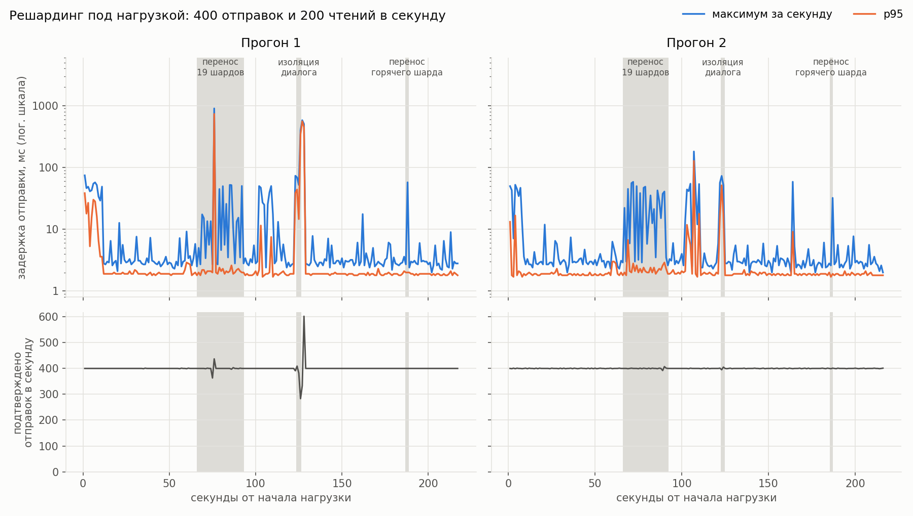

# Отчёт: шардинг диалогов

Цель: хранить сообщения диалогов так, чтобы запись масштабировалась горизонтально, шарды можно было перераспределять без
остановки сервиса, а очень активный пользователь («эффект Леди Гаги») не перегружал один узел.

## Итоги

- Методы `POST /dialog/{userId}/send` и `GET /dialog/{userId}/list` реализованы в обоих приложениях (`apps/native`,
  `apps/symfony`) по контракту [`docs/openapi.json`](../openapi.json).
- Сообщения лежат в отдельном кластере **Citus** (координатор и воркеры), распределены по **64 шардам**. Приложения знают
  только координатор.
- **Ключ шардирования — `dialog_id`**, идентификатор пары участников. Отправка и чтение диалога идут на один шард, а
  сообщения «Леди Гаги» расходятся по всем шардам: 50,3% и 49,7% на двух воркерах против 100% на одном шарде при ключе
  `sender_id`.
- **Запись масштабируется**: 4775 → 6989 → 9389 вставок/с на 2, 3 и 4 воркерах (×1,46 и ×1,97), пока координатору хватает
  CPU. При 1 CPU у координатора прироста нет: узким местом становится он сам.
- **Решардинг без даунтайма**: под нагрузкой 400 отправок и 200 чтений в секунду добавлен воркер и перенесено 19 шардов,
  горячий диалог выделен в свой шард и перенесён на отдельный узел. В двух прогонах **0 ошибок, 0 потерянных и 0
  задвоенных сообщений**. Паузы при этом есть: максимальная задержка запроса 902 мс в одном прогоне и 181 мс в другом.
- Смена **числа** шардов, в отличие от их переноса, запись останавливает (раздел 5.6), поэтому шардов взято с запасом.

Все цифры из каталога [`results/`](results/), команды воспроизведения в разделе 7.

## 1. Что реализовано

| Метод | Вход | Ответ |
|---|---|---|
| `POST /dialog/{userId}/send` | Bearer-токен, `{"text": "..."}` | 204; 400 на пустой или слишком длинный текст и сообщение себе; 401; 404, если получателя нет |
| `GET /dialog/{userId}/list` | Bearer-токен, `limit` (1–100, по умолчанию 50), `before` | 200, `[{id, from, to, text}]` от старых к новым; 400; 401 |

Отступления от [спецификации OTUS](https://github.com/OtusTeam/highload/blob/master/homework/openapi.json) (каждое описано в
`description` операции): путь с `{userId}`, а не `{user_id}`; `send` отвечает 204, а не 200; несуществующий получатель — 404;
у `list` пагинация по курсору для подгрузки истории при прокрутке и поле `id` в элементах.

Бизнес-логика в [`packages/core`](../../packages/core) (use cases `SendMessage` и `GetDialog`, порты `MessageRepository` и
`MessageIdGenerator` с contract-тестами), в приложениях PDO-репозиторий, подключение к координатору и контроллеры. Экран
диалога с подгрузкой при прокрутке есть во [`frontend/`](../../frontend) (`#/dialog/<id>`, dev-режим, http://localhost:8080).

## 2. Стенд и топология

```
php-native ─┐  DB_HOST ─────────► postgres (анкеты, друзья, посты; primary и 2 реплики, как раньше)
            ├─ DB_READ_HOST ────► haproxy ─► реплики
php-symfony ┘  DIALOGS_DB_HOST ─► dialogs-coordinator ─┬─► dialogs-worker-1  ┐ шарды dialog_messages
                                                       ├─► dialogs-worker-2  ┘
                                                       ├─► dialogs-worker-3  ┐ профиль reshard:
                                                       └─► dialogs-worker-4  ┘ добавляются при решардинге
```

| Параметр | Значение |
|---|---|
| Хост | AMD Ryzen 9 9950X (16 ядер, 32 потока), 59 ГБ RAM, Linux 6.14, Docker 28.0.2 |
| Кластер диалогов | `citusdata/citus:14.2.0-pg17` (PostgreSQL 17.10, Citus 14.2) |
| Лимиты | координатор 1 CPU и 512 МБ; каждый воркер **0,5 CPU и 512 МБ** |
| Конфиг | один [`postgresql.conf`](../../social-network-docker/citus/postgresql.conf): `wal_level = logical`, `shared_buffers = 128MB` |
| Приложения | режим bench, 2 CPU и 512 МБ, php-fpm `pm=static`, **4 воркера**, постоянные соединения |
| Данные | 2 000 000 сообщений в 90 000 диалогах, около 660 МБ с индексом |

Кластер диалогов отдельный: основной PostgreSQL с репликами не менялся, анкеты, друзья и посты не шардируются. Узлы
регистрирует и применяет миграции разовый сервис `dialogs-init`
([`cluster-init.sh`](../../social-network-docker/citus/cluster-init.sh)). Узлы подключаются друг к другу по SSL (его
включает Citus), пароль берётся из `.pgpass`, который пишется из окружения при старте.

## 3. Схема и ключ шардирования

### 3.1 Таблица

[`db/dialogs/migrations/001_create_dialog_messages.sql`](../../db/dialogs/migrations/001_create_dialog_messages.sql):

```sql
CREATE TABLE dialog_messages (
    dialog_id    UUID          NOT NULL,   -- ключ шардирования
    id           UUID          NOT NULL,   -- UUIDv7: порядок истории и курсор
    sender_id    UUID          NOT NULL,
    recipient_id UUID          NOT NULL,
    text         VARCHAR(2000) NOT NULL CHECK (btrim(text) <> ''),
    created_at   TIMESTAMPTZ   NOT NULL DEFAULT now(),
    PRIMARY KEY (dialog_id, id),
    CHECK (sender_id <> recipient_id)
);
SELECT create_distributed_table('dialog_messages', 'dialog_id', shard_count => 64);
```

- **Первичный ключ `(dialog_id, id)`** обслуживает и выборку страницы, и сортировку; других индексов нет. Он же нужен
  Citus: ключ распределённой таблицы обязан включать ключ шардирования, а логической репликации при переносе шардов нужна
  replica identity.
- **Внешних ключей на `users` нет**: пользователи в другой базе. Получателя проверяет приложение на реплике основной БД с
  возвратом к primary при промахе.

### 3.2 Выбор ключа

| Ключ | Чтение диалога | Активный пользователь | Решение |
|---|---|---|---|
| `sender_id` | два шарда (сообщения обоих участников) | всё написанное им на одном шарде | нет |
| `recipient_id` | два шарда | всё входящее на одном шарде | нет |
| случайный (`id` сообщения) | все шарды | распределён ровно | нет: чтение обходит весь кластер |
| **`dialog_id` (пара участников)** | **один шард** | расходится по шардам вместе с диалогами | **да** |

`dialog_id` нигде не передаётся клиентом, а вычисляется по паре участников: первые 16 байт SHA-256 строки «меньший
id:больший id» с битами версии 8 UUID ([`DialogId`](../../packages/core/src/Domain/Dialog/DialogId.php)). Он одинаков для
обоих направлений. Способ вычисления менять нельзя (записанные сообщения перестали бы находиться), поэтому эталонное
значение закреплено unit-тестом; сид вычисляет `dialog_id` в SQL и сверяется с тем же эталоном.

### 3.3 «Эффект Леди Гаги»

Данные с перекосом ([`dialogs.sql`](../../db/dialogs/seed/dialogs.sql)): у «Леди Гаги» 400 000 сообщений в диалогах с 20 000
собеседников (из них 360 193 написала она), ещё 200 000 сообщений в одной «горячей» переписке, остальные 1 400 000 в 70 000
фоновых диалогах. Для сравнения создавалась копия таблицы с ключом `sender_id`
([`dialog-skew.sql`](../../social-network-docker/bench/dialog-skew.sql), итог в [`results/skew.txt`](results/skew.txt)).

| Сообщения, написанные «Леди Гагой» | worker-1 | worker-2 | Шардов с ними |
|---|---|---|---|
| ключ `dialog_id` | 181 313 (50,3%) | 178 880 (49,7%) | 64 |
| ключ `sender_id` | 0 | 360 193 (100%) | 1 |

| Все 2 000 000 сообщений, 2 воркера | worker-1 / worker-2 | Самый большой шард к среднему |
|---|---|---|
| ключ `dialog_id` | 45,1% / 54,9% | 7,4 (229 841 против 31 250) |
| ключ `sender_id` | 41,2% / 58,8% | 12,3 (383 282 против 31 250) |

При ключе `dialog_id` оставшийся перекос даёт горячий диалог: вся переписка пары лежит в одном шарде. Это решается
выделением диалога в отдельный шард (раздел 5.5).

### 3.4 Эффективность схемы

Планы с живого кластера ([`results/explain.txt`](results/explain.txt)), запрос к горячему диалогу:

| Запрос | Задач (шардов) | Время на воркере | Прочитано буферов |
|---|---|---|---|
| Страница по курсору `id < before` после 100 000 более новых сообщений (так делает приложение) | 1 | 0,16 мс | 55 |
| Та же глубина через `OFFSET 100000` (для сравнения) | 1 | 80,9 мс | 99 389 |
| Вставка сообщения | 1 | 0,11 мс | — |
| Запрос без ключа шардирования (`WHERE sender_id = …`, приложение таких не делает) | 66 | — | — |

- Отправка и чтение выполняются **на одном воркере**, чтение идёт по первичному ключу в обратном порядке.
- **Курсор вместо `offset`**: стоимость страницы не растёт с глубиной прокрутки, а новые сообщения не сдвигают уже
  загруженные страницы.
- **UUIDv7** упорядочен по времени, поэтому отдельный индекс по времени не нужен. Порядок сообщений, созданных в пределах
  одной миллисекунды, не определён, но стабилен.
- Цена выбранного ключа: запрос «список моих диалогов» обходил бы все шарды. В задании его нет; при необходимости для него
  нужна отдельная таблица, распределённая по пользователю.

## 4. Горизонтальное масштабирование записи

`make bench-dialog-scale` ([`dialog-scale.sh`](../../social-network-docker/bench/dialog-scale.sh)): pgbench из отдельного
контейнера вставляет сообщения **прямо на координатор**, 64 клиента, 30 с после прогрева, пустая таблица, по два прогона.
Отдельный одноразовый кластер, воркеры по 0,5 CPU. Результаты: [`results/write-scaling/`](results/write-scaling/summary.md).

| Воркеров (шардов на узел) | Координатор 4 CPU, вставок/с | К двум воркерам | CPU воркера | Координатор 1 CPU, вставок/с | К двум воркерам | CPU воркера |
|---|---|---|---|---|---|---|
| 2 (32/32) | 4775 | ×1,00 | 48% | 4012 | ×1,00 | 41% |
| 3 (22/21/21) | 6989 | ×1,46 | 48% | 4082 | ×1,02 | 30% |
| 4 (16 на каждом) | 9389 | ×1,97 | 48% | 4175 | ×1,04 | 24% |

CPU в процентах одного ядра, предел воркера 50%. Ошибок нет, прогоны одной конфигурации расходятся не более чем на 3%.

- **Когда воркеры упираются в свой лимит, запись растёт почти линейно** (98% от линейного роста).
- **Следующий предел — координатор**: с 1 CPU он загружен на 100% и добавление узлов почти ничего не даёт. Варианты: больше
  CPU координатору или приём запросов на воркерах (метаданные Citus на них синхронизированы); второй вариант не проверялся.
- **Через приложение** отправка упирается раньше: около 1650 запросов/с при 8 параллельных клиентах и 1950 при 32
  ([`results/calibration.txt`](results/calibration.txt)). Воркеры Citus при этом загружены на 13–20% ядра, координатор на
  37–40%, так что предел, по всей видимости, в 4 воркерах php-fpm, а не в БД.

## 5. Решардинг без даунтайма

### 5.1 Принцип

Логических шардов 64, и это число не меняется. Решардинг — это перенос шардов между физическими узлами и добавление
узлов; приложения при этом ничего не меняют. Citus переносит шард логической репликацией PostgreSQL:

1. создаёт пустой шард на узле-приёмнике, публикацию на источнике и подписку на приёмнике;
2. копирует данные, **чтение и запись идут в старый шард**;
3. доставляет изменения, накопившиеся за время копирования;
4. коротко переключает: запись в переносимый шард ждёт, пока приёмник догонит источник, затем меняются метаданные;
5. старый шард удаляется позже, фоновым процессом (deferred drop).

Лог координатора при изоляции горячего диалога ([`coordinator.log`](results/reshard-repeat/coordinator.log)):

```
13:14:49.198  performing non-blocking isolate_tenant_to_new_shard
13:14:49.212  creating child shards for isolate_tenant_to_new_shard
13:14:49.228  creating replication artifacts (publications, replication slots, subscriptions ...
13:14:49.305  performing copy for isolate_tenant_to_new_shard
13:14:50.515  replicating changes for isolate_tenant_to_new_shard
13:14:51.520  The LSN of the target subscriptions on node dialogs-worker-3:5432 have caught up with the source LSN
13:14:51.528  marking deferred cleanup of source shard(s) for isolate_tenant_to_new_shard
13:15:01.936  deferred drop of orphaned resource public.dialog_messages_102011 on dialogs-worker-3:5432 completed
```

### 5.2 Что должно быть настроено заранее

- `wal_level = logical` на всех узлах, запас `max_replication_slots`, `max_wal_senders`, `max_logical_replication_workers`
  и `max_worker_processes`;
- первичный ключ (replica identity) у распределённой таблицы;
- новый узел с той же версией Citus и PostgreSQL, доступный по сети остальным узлам, с паролем для подключений между ними.

### 5.3 Порядок действий

SQL выполняется на координаторе (`make dialogs-psql`).

```bash
# 1. Поднять новый узел
docker compose --profile reshard up -d --wait dialogs-worker-3
```

```sql
-- 2. Зарегистрировать его. Шарды на нём пока не появляются.
SELECT citus_add_node('dialogs-worker-3', 5432);

-- 3. Посмотреть, что будет перенесено
SELECT * FROM get_rebalance_table_shards_plan();

-- 4. Запустить перенос фоновым заданием и следить за ним
SELECT citus_rebalance_start();
SELECT state, details->'task_state_counts' FROM citus_rebalance_status();
SELECT citus_rebalance_wait();          -- или citus_rebalance_stop() для отмены

-- 5. Проверить распределение (то же показывает make dialogs-status)
SELECT nodename, count(*), pg_size_pretty(sum(shard_size)) FROM citus_shards GROUP BY nodename;
```

Для вывода узла из кластера есть `citus_drain_node` и затем `citus_remove_node`; отмена переноса и вывод узла **в этой
работе не проверялись**. Описание функций: [документация Citus](https://docs.citusdata.com/en/v13.0/develop/api_udf.html).

### 5.4 Горячий диалог: отдельный шард и отдельный узел

```sql
-- Найти самые большие диалоги (обходит все шарды: запускать не под пиковой нагрузкой)
SELECT dialog_id, count(*) FROM dialog_messages GROUP BY dialog_id ORDER BY count(*) DESC LIMIT 10;

-- Выделить диалог в собственный шард; функция возвращает id нового шарда
SELECT isolate_tenant_to_new_shard('dialog_messages', '<dialog_id>', shard_transfer_mode => 'auto');
SELECT nodename FROM pg_dist_shard_placement WHERE shardid = <shard>;

-- Добавить пустой узел и перенести на него один этот шард
SELECT citus_add_node('dialogs-worker-4', 5432);
SELECT citus_move_shard_placement(<shard>, '<текущий узел>', 5432, 'dialogs-worker-4', 5432, shard_transfer_mode => 'auto');
```

Изоляция разрезает исходный шард по диапазонам хеша, поэтому шардов становится 66. Следующая обычная ребалансировка может
перенести на выделенный узел другие шарды (или унести с него горячий): чтобы закрепить узел за диалогом, нужна своя
стратегия ребалансировки. Это не проверялось.

Ограничение схемы: **один диалог не делится**, его запись ограничена одним узлом. Если этого станет мало, ключ можно
расширить до «диалог + номер порции», ценой чтения нескольких шардов.

### 5.5 Эксперимент под нагрузкой

`make bench-dialog-reshard` ([`dialog-reshard.sh`](../../social-network-docker/bench/dialog-reshard.sh)): k6 держит
**постоянный поток 400 отправок и 200 чтений в секунду** через native (10% запросов в горячий диалог, 20% в диалоги «Леди
Гаги»). Поток не зависит от скорости ответов, поэтому паузы не маскируются снижением нагрузки. Текст каждого сообщения —
уникальная метка; после прогона подтверждённые (204) сообщения сверяются с БД. Два прогона на свежем кластере:
[прогон 1](results/reshard/summary.md), [прогон 2](results/reshard-repeat/summary.md).



**Максимальная задержка запроса по этапам, мс** (отправка / чтение):

| Этап | Длительность | Прогон 1 | Прогон 2 |
|---|---|---|---|
| до изменений | 66 с | 75 / 51 | 53 / 44 |
| `citus_add_node` третьего воркера | 0,2 с | 3 / 2 | 3 / 2 |
| перенос 19 шардов | 25–26 с | **902 / 768** | 59 / 49 |
| пауза после переноса | 30 с | 50 / 34 | 181 / 158 |
| изоляция горячего диалога | 2,5–2,9 с | 402 / 317 | 73 / 58 |
| пауза после изоляции | 30 с | **582 / 698** | 6 / 4 |
| `citus_add_node` четвёртого воркера | 0,2 с | 3 / 2 | 3 / 1 |
| перенос горячего шарда на него | 2 с | 58 / 2 | 32 / 2 |
| после изменений | 30 с | 9 / 8 | 8 / 9 |

| Итог за прогон | Прогон 1 | Прогон 2 |
|---|---|---|
| Подтверждено отправок / чтений | 87 457 / 43 729 | 86 874 / 43 437 |
| Ошибки сервера | 0 | 0 |
| Потеряно подтверждённых / дублей | 0 / 0 | 0 / 0 |
| Дольше всего без единой успешной отправки | 768 мс | 112 мс |
| p50 / p99 всех запросов | 1,6 / 279 мс | 1,6 / 3,5 мс |

В обоих прогонах один запрос оборван остановкой k6 в конце (статус 0); в прогоне 1 это сообщение успело записаться.

**Распределение до и после** (прогон 1, [`distribution.txt`](results/reshard/distribution.txt)):

| Узел | До: шардов / сообщений | После: шардов / сообщений |
|---|---|---|
| worker-1 | 32 / 902 215 | 23 / 660 262 |
| worker-2 | 32 / 1 097 785 | 22 / 633 654 |
| worker-3 | — | 20 / 584 909 |
| worker-4 | — | **1 / 208 633** (горячий диалог) |

**Откуда паузы.** По времени всплески приходятся на переключение шардов (шаг 4 в разделе 5.1) и первые секунды после него.
Пауза одного шарда видна не только в запросах к нему: в [проверке](results/lock-probe.txt) блокировка одного шарда из 66
на 1 с задержала дольше 300 мс **10% всех запросов, включая чтения**. Запросы к заблокированному шарду занимают воркеры
php-fpm (их 4), и остальные ждут свободного. Смягчать это можно большим пулом, повтором на клиенте и решардингом вне пика;
эти меры не измерялись.

Первые прогоны дали ложные результаты и показательны как предостережение: подсчёт строк по всем шардам во время нагрузки
сам вызвал всплеск до 1,3 с, поэтому теперь скрипт под нагрузкой читает только метаданные. Ещё один предварительный прогон
([`results/preliminary-run/`](results/preliminary-run/README.md)) показал всплеск до 1,2 с сразу после изоляции, когда
следующая операция шла без паузы.

### 5.6 Что делает даунтайм: смена числа шардов

Проверено на отдельном кластере с 1 000 000 сообщений
([`results/alter-shard-count.txt`](results/alter-shard-count.txt)): `alter_distributed_table(…, shard_count => 128)` занял
9 с, всё это время почти не шла запись (**8 секунд подряд ни одной транзакции**), чтение останавливалось на 3 секунды.
Ошибок не было, запросы ждали, но это уже простой, и с объёмом данных он будет расти. Поэтому число шардов выбирается
заранее с запасом: 64 шардов хватает, чтобы долго расти одним только переносом на новые узлы.

## 6. Ограничения

- **«Без даунтайма» не значит «без задержек»**: сервис отвечал всё время и ничего не потерял, но отдельные запросы ждали
  почти секунду (в предварительном прогоне 1,2 с). Разброс между прогонами большой, а прогонов всего два.
- **Координатор — единая точка отказа и предел записи.** Резервирование координатора и воркеров не настраивалось: потеря
  воркера делает недоступными его диалоги.
- **После перезапуска координатора** первый запрос каждого воркера php-fpm завершается ошибкой 500: постоянное соединение
  уже мертво. Скрипт эксперимента перезапускает php перед прогоном.
- **После решардинга** `make up` не поднимает третий и четвёртый воркеры; `dialogs-init` об этом предупреждает.
- **Отправка зависит от основной БД**: получатель проверяется на реплике (при промахе на primary).
- Все узлы на одной машине с общим диском; на отдельных серверах цифры будут другими. Масштабирование записи измерено мимо
  приложения и на пустой таблице.

## 7. Как запустить и воспроизвести

Нужны только Docker с Compose v2 и make (подробности в [корневом README](../../README.md)).

```bash
make init
```

```bash
make install
```

```bash
make up
```

Этого достаточно, чтобы пользоваться диалогами (native на порту 8081, Symfony на 8082):

```bash
curl -i -X POST http://localhost:8081/dialog/<id получателя>/send -H "Authorization: Bearer <token>" -d '{"text":"Привет"}'
```

```bash
curl -i "http://localhost:8081/dialog/<id собеседника>/list?limit=20" -H "Authorization: Bearer <token>"
```

Замеры. Для сида нужна заполненная таблица пользователей (`make seed`, файл `people.v2.csv` из задания OTUS в
`db/seed/`, в git не хранится):

```bash
make seed-dialogs            # 2 млн сообщений с перекосом, около минуты
make dialogs-skew            # раздел 3.3
make bench-dialog-scale      # раздел 4, около 10 минут, свой одноразовый кластер
make bench-up                # замеры через приложение только в режиме bench
make bench-dialog-users      # участники и токены для нагрузки
make bench-dialog-reshard    # раздел 5.5, прогон 1, около 4 минут
make dialogs-rebuild         # УДАЛЯЕТ сообщения: кластер с нуля перед повторным прогоном
make bench-dialog-users
make bench-dialog-reshard PHASE=reshard-repeat
make bench-dialog-plot       # график по двум прогонам
```

Проверка контракта: `make test-core test-native test-symfony`, Postman-коллекция `docs/postman/` (папка «Dialog»),
`make compare`, `make compare-infrastructure`. На момент отчёта: 332, 213 и 211 тестов, Postman 204 проверки из 204 у
каждого приложения (в том числе на стеке, поднятом с пустых томов), `make compare` 483 кейса без новых расхождений.

## 8. Файлы

| Что | Где |
|---|---|
| Кластер: конфиг, инициализация, статус, пересборка | [`social-network-docker/citus/`](../../social-network-docker/citus) |
| Схема и сид | [`db/dialogs/`](../../db/dialogs) |
| Нагрузка и эксперименты | `social-network-docker/bench/dialog*` |
| Результаты | [`results/`](results) |
| График | [`img/reshard.png`](img/reshard.png) |
